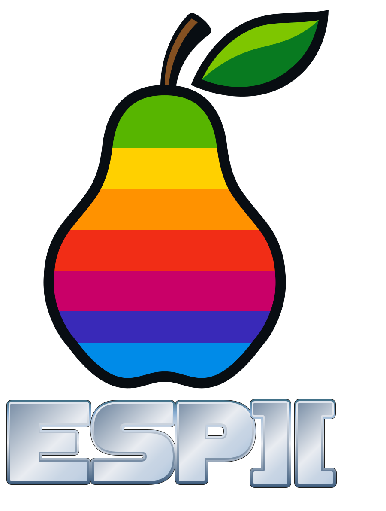
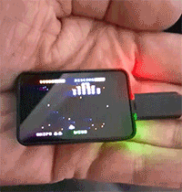

<p align="center">
  
</p>

**ESP][ — An Apple in a hand.**

*Better an Apple in the hand than a dove on the roof.*

<p align="center">
  
</p>

*English (below) · [Deutsch](#deutsch)*

<p align="center">
  <a href="https://microgulp.dev/ready/">
    
  </a>
</p>

> **🚧 Work in Progress**
>
> This project is under active development.
> Hardware, firmware, APIs, documentation and compatibility may change.

**ESP][** is an experimental hobby / open-source project: a miniature, self-contained **Apple II / Apple II+–compatible system** on the **Waveshare ESP32-S3-Touch-AMOLED-1.64** board — computer, display, and virtual Disk II in a pocket-sized package.

Package / repo identifier (ASCII): `esp2` — the visible project name remains **ESP][**.

### Important status note

- ESP][ is **not finished**.
- Distinguish **HOST_VERIFIED** (desktop tests) from **physically verified** on the ESP32-S3 / CO5300.
- **Apple system ROMs** and **commercial disk images** (e.g. Galaxian) are **not** distributed in this repository — they remain **user-supplied local runtime assets**.
- A visible playfield does **not** mean a title is fully playable (gamepad / audio may still be untested).

---

## Current milestone: Galaxian on physical ESP][

**`GALAXIAN_ESP32 = PASS`**

**`MICROS_WRAP_REGRESSION = PASS`** · **`GALAXIAN_2H_SOAK = PASS`**

Real Apple II software executes on the board through the normal emulator stack — **not** a native Galaxian port, **not** a canned screenshot, **not** a fake firmware animation:

```
Apple II+ system ROM (user-supplied)
    → NMOS 6502 emulation
    → Disk II emulation
    → Galaxian disk image (user-supplied)
    → Apple II HGR video memory
    → Artifact Color renderer (generic HGR path)
    → physical CO5300 AMOLED
```

### Galaxian — 2-hour physical soak test passed

Continuous Apple II execution remained stable beyond the former **32-bit microsecond timer-wrap** boundary (~71.6 minutes). Verified on physical ESP][ (`apple2_text`, COM5): cycles kept advancing, cps ≈ 1.023 MHz, HGR active. That closes the known long-run throttle stall; it does **not** claim overnight or all-title stability. Details: `docs/architecture/apple2-throttle.md`, `docs/apple2/galaxian-2h-soak.json`.

Physically verified so far (summary):

| Check | Result |
| --- | --- |
| Apple II+ reset / interactive ROM startup | PASS |
| Galaxian DSK mount / Autostart boot | PASS |
| Cracktro → keyboard **A** → second disk load | PASS |
| Recognizable Galaxian HGR playfield | PASS |
| Presentation matrix (Orient × Monitor × Effect incl. CRT) | PASS (physical) |
| Emulated speed | ≈ **1.023 MHz** (Artifact Color raises render cost; clock not slowed) |
| Former ~71.6 min `micros()` throttle wrap | **PASS** (`MICROS_WRAP_REGRESSION`) |
| Galaxian ≥ 2 h physical soak | **PASS** (`GALAXIAN_2H_SOAK`) |
| Windows keyboard bridge | PASS |
| Startup macro input (`galaxian-start`) | infrastructure **IMPLEMENTED** |
| 8BitDo gameplay | **NOT_TESTED** |
| Logitech Dial → paddle path | **DEV** (host bridge; not a physical PASS claim) |
| Physical speaker / Bluetooth audio | **NOT_TESTED** |

Getting real Galaxian running exposed generic Disk II accuracy work (DOS 3.3 physical Address Field mapping and half-track stepper behavior) — not title-specific emulator hacks. Details: `docs/apple2/boot-forensics.md`, `docs/apple2/disk-ii.md`.

---

## Then vs. now

During compulsory military service, I was allowed to take my Apple II with me. I transported it in a suitcase. Carrying that setup around was a lot of hardware — a lot of hauling.

| Then | Now |
| --- | --- |
| Apple II in a suitcase | **ESP][ in the hand** |

**ESP][ — An Apple in a hand.**

Storage is no longer the limiting factor. **Human eyesight is.** On the tiny AMOLED a magnifying glass may be the most useful optional peripheral.

---

## How many floppies fit on 2 TB?

A standard DOS 3.3 Apple II 5.25″ disk image is:

```
35 tracks × 16 sectors × 256 bytes = 143,360 bytes ≈ 140 KiB
```

A nominal **2 TB** (= 2,000,000,000,000 bytes) of raw capacity holds about:

```
2,000,000,000,000 / 143,360 ≈ 13.95 million
```

raw **140 KiB DSK-equivalent** images — roughly **13.95 million** Apple II floppies.

That is a **fun theoretical comparison**. It ignores filesystem overhead, other ESP][ files, practical filesystem limits, and larger formats such as WOZ/NIB. It is **not** a WOZ count and does **not** claim a 2 TB card stores 13.95 million WOZ files.

At an illustrative ~**1.5 mm** per physical floppy, that stack would be about:

```
13.95e6 × 1.5 mm ≈ 21 km
```

of disks. Thickness is an approximation for fun — not a lab measurement.

---

## Persistent configuration & startup macros

ESP][ can store a **device profile** on the microSD (`/esp2/config/system.json` + `macros.json`):

- system ROM path
- Drive 1 / Drive 2 image paths
- boot from disk (Autostart)
- presentation (orientation + HGR color mode)
- screensaver idle timeout
- optional **startup macro**
- named macros that can also be run manually

This is **generic infrastructure**. Title behavior lives in **user profiles** under `config/device/profiles/` — not hardcoded in the emulator core.

### Tracked demo profiles (paths only)

Disk images are **never** in Git. Activate media locally after clone with µGulp **`setup:profiles`** (or `setup:first-run` for a single demo title).

| Profile id | Drive 1 (device path) | Presentation | Notes |
| --- | --- | --- | --- |
| `galaxian-demo` | `/esp2/disks/Galaxian.dsk` | landscape / artifact | Startup macro `galaxian-start` |
| `little-brick-out` | `/esp2/disks/LittleBrickOut.dsk` | landscape / white | LORES + paddle / Dial; macro `little-brick-out-start` |
| `star-blazer` | `/esp2/disks/StarBlazer.dsk` | landscape / artifact | HGR demo; empty macros |

Example **galaxian-demo** fields:

| Field | Value |
| --- | --- |
| ROM | `/esp2/roms/system.rom` |
| Drive 1 | `/esp2/disks/Galaxian.dsk` |
| Boot from disk | `true` |
| Orientation | `landscape` |
| Color | `artifact` |
| Screensaver | `300` seconds |
| Startup macro | `galaxian-start` |

### Apple ][js catalog profiles (downloadable)

Path-only **device profiles** under `config/device/profiles/<id>/` reference titles from [Apple ][js](https://www.scullinsteel.com/apple2). Each entry has a device disk **path**; media is fetched from the website JSON URL (e.g. `…/json/disks/starblazer.json`) — **not** stored in Git.

Download after clone (gitignored `local/apple2/`, LOCAL_TEST_ONLY):

```bash
npx gulp setup:profiles
npx gulp setup:profiles --profile star-blazer --seed star-blazer
npx gulp setup:profiles --profile category:Game
```

Also written as a standalone file: [`docs/device/generated/profile-catalog.md`](docs/device/generated/profile-catalog.md). Regenerate profiles + this list: `npx gulp device:profiles:generate`.
Generated from `config/device/profiles/`. **Path-only** - no disk images in Git.

Each catalog profile points at an [Apple ][js](https://www.scullinsteel.com/apple2) media URL (JSON disk). Download into gitignored `local/apple2/` with:

```bash
npx gulp setup:profiles
npx gulp setup:profiles --profile star-blazer --seed star-blazer
```

Commercial / entertainment titles remain **USER_SUPPLIED_ONLY / LOCAL_TEST_ONLY** - website availability is not redistribution permission.

Profiles: **251**. Regenerate: `gulp device:profiles:generate` or `node dev/tools/device-profile-catalog-doc.mjs`.

## Categories

| Category | Count |
| --- | ---: |
| 13 Sector | 12 |
| Demo | 9 |
| Demo (curated) | 3 |
| Diagnostics | 5 |
| Educational | 9 |
| Game | 134 |
| Graphics | 7 |
| Interactive Fiction | 37 |
| Music Video | 1 |
| Personal | 2 |
| Productivity | 7 |
| Programming | 10 |
| System | 5 |
| Utility | 10 |

## Curated demos

| Title | Profile id | Device path | Apple ][js media URL |
| --- | --- | --- | --- |
| Galaxian | `galaxian-demo` | `/esp2/disks/Galaxian.dsk` | https://www.scullinsteel.com/apple2/json/disks/galaxian.json |
| Little Brick Out | `little-brick-out` | `/esp2/disks/LittleBrickOut.dsk` | (user-supplied / not on website catalog) |
| Star Blazer | `star-blazer` | `/esp2/disks/StarBlazer.dsk` | https://www.scullinsteel.com/apple2/json/disks/starblazer.json |

## All profiles (by category)

### 13 Sector

| Title | Profile id | Apple ][js media URL |
| --- | --- | --- |
| Boot 13 | `boot-13` | https://www.scullinsteel.com/apple2/json/disks/boot13.json |
| DOS 3.1 Master | `dos-31-master` | https://www.scullinsteel.com/apple2/json/disks/dos31master.json |
| DOS 3.2 Master | `dos-32-master` | https://www.scullinsteel.com/apple2/json/disks/dos32master.json |
| DOS 3.2 Master 2 | `dos-32-master-2` | https://www.scullinsteel.com/apple2/json/disks/dos32master2.json |
| SoftSide 1981-11 | `softside-1981-11` | https://www.scullinsteel.com/apple2/json/disks/ss_1981_11.json |
| SoftSide 1982-03 | `softside-1982-03` | https://www.scullinsteel.com/apple2/json/disks/ss_1982_03.json |
| SoftSide 1982-04 | `softside-1982-04` | https://www.scullinsteel.com/apple2/json/disks/ss_1982_04.json |
| SoftSide 1982-05 | `softside-1982-05` | https://www.scullinsteel.com/apple2/json/disks/ss_1982_05.json |
| SoftSide 30 | `softside-30` | https://www.scullinsteel.com/apple2/json/disks/ss_30.json |
| SoftSide 31 | `softside-31` | https://www.scullinsteel.com/apple2/json/disks/ss_31.json |
| SoftSide 32 | `softside-32` | https://www.scullinsteel.com/apple2/json/disks/ss_32.json |
| SoftSide 33 | `softside-33` | https://www.scullinsteel.com/apple2/json/disks/ss_33.json |

### Demo

| Title | Profile id | Apple ][js media URL |
| --- | --- | --- |
| 1984 Christmas Demo | `1984-christmas-demo` | https://www.scullinsteel.com/apple2/json/disks/xmas_demo.json |
| Apple Presents the //e (1985) | `apple-presents-the-e-1985` | https://www.scullinsteel.com/apple2/json/disks/apple2edemo2.json |
| Apple Presents the //e (1986) | `apple-presents-the-e-1986` | https://www.scullinsteel.com/apple2/json/disks/apple2edemo3.json |
| Apple Presents the Apple IIe | `apple-presents-the-apple-iie` | https://www.scullinsteel.com/apple2/json/disks/apple2edemo1.json |
| Extended 80 Column Demo | `extended-80-column-demo` | https://www.scullinsteel.com/apple2/json/disks/ext80demo2.json |
| Festro | `festro` | https://www.scullinsteel.com/apple2/json/disks/festro.json |
| RGB Color Card (DOS) | `rgb-color-card-dos` | https://www.scullinsteel.com/apple2/json/disks/rgb_dos.json |
| RGB Color Card (Prodos) | `rgb-color-card-prodos` | https://www.scullinsteel.com/apple2/json/disks/rgb_prodos.json |
| Video 7 | `video-7` | https://www.scullinsteel.com/apple2/json/disks/video7.json |

### Demo (curated)

| Title | Profile id | Apple ][js media URL |
| --- | --- | --- |
| Galaxian | `galaxian-demo` | https://www.scullinsteel.com/apple2/json/disks/galaxian.json |
| Little Brick Out | `little-brick-out` | - |
| Star Blazer | `star-blazer` | https://www.scullinsteel.com/apple2/json/disks/starblazer.json |

### Diagnostics

| Title | Profile id | Apple ][js media URL |
| --- | --- | --- |
| Apple ][+ Diagnostics | `apple-diagnostics` | https://www.scullinsteel.com/apple2/json/disks/diagnostics2plus.json |
| Apple //e Diagnostics 2.0 | `apple-e-diagnostics-20` | https://www.scullinsteel.com/apple2/json/disks/diagnostics2e2.json |
| Apple //e Diagnostics 2.1 | `apple-e-diagnostics-21` | https://www.scullinsteel.com/apple2/json/disks/diagnostics2e.json |
| Audit | `audit` | https://www.scullinsteel.com/apple2/json/disks/audit.json |
| MECC Computer Inspector | `mecc-computer-inspector` | https://www.scullinsteel.com/apple2/json/disks/mecc_a240.json |

### Educational

| Title | Profile id | Apple ][js media URL |
| --- | --- | --- |
| Carmen Sandiego 1 | `carmen-sandiego-1` | https://www.scullinsteel.com/apple2/json/disks/carmen1.json |
| Carmen Sandiego 2 | `carmen-sandiego-2` | https://www.scullinsteel.com/apple2/json/disks/carmen2.json |
| Latin Skills I: Cursus Honorum | `latin-skills-i-cursus-honorum` | https://www.scullinsteel.com/apple2/json/disks/latin1.json |
| Latin Skills II: Verb Factory | `latin-skills-ii-verb-factory` | https://www.scullinsteel.com/apple2/json/disks/latin2.json |
| Latin Skills III: Mare Nostrum | `latin-skills-iii-mare-nostrum` | https://www.scullinsteel.com/apple2/json/disks/latin3.json |
| Latin Skills IV: Translat | `latin-skills-iv-translat` | https://www.scullinsteel.com/apple2/json/disks/latin4.json |
| Latin Skills V: Artifex Verborum | `latin-skills-v-artifex-verborum` | https://www.scullinsteel.com/apple2/json/disks/latin5.json |
| Number Squares | `number-squares` | https://www.scullinsteel.com/apple2/json/disks/numbersquares.json |
| Odell Lake | `odell-lake` | https://www.scullinsteel.com/apple2/json/disks/odell_lake.json |

### Game

| Title | Profile id | Apple ][js media URL |
| --- | --- | --- |
| Adventure | `adventure` | https://www.scullinsteel.com/apple2/json/disks/adventure.json |
| Airheart | `airheart` | https://www.scullinsteel.com/apple2/json/disks/airheart.json |
| Akalabeth | `akalabeth` | https://www.scullinsteel.com/apple2/json/disks/akalabeth.json |
| Ancient Legends | `ancient-legends` | https://www.scullinsteel.com/apple2/json/disks/ancient_legends_2.json |
| Apple Invaders | `apple-invaders` | https://www.scullinsteel.com/apple2/json/disks/appleinvaders.json |
| Apple Panic | `apple-panic` | https://www.scullinsteel.com/apple2/json/disks/apple_panic.json |
| Apple Trek | `apple-trek` | https://www.scullinsteel.com/apple2/json/disks/appletrek.json |
| Applesoft Games | `applesoft-games` | https://www.scullinsteel.com/apple2/json/disks/applesoft.json |
| Apventure to Atlantis | `apventure-to-atlantis` | https://www.scullinsteel.com/apple2/json/disks/atlantis.json |
| Archon | `archon` | https://www.scullinsteel.com/apple2/json/disks/archon.json |
| Archon II | `archon-ii` | https://www.scullinsteel.com/apple2/json/disks/archon2.json |
| Arkanoid | `arkanoid` | https://www.scullinsteel.com/apple2/json/disks/arkanoid.json |
| Artic Fox | `artic-fox` | https://www.scullinsteel.com/apple2/json/disks/artic_fox.json |
| Asteroid Field | `asteroid-field` | https://www.scullinsteel.com/apple2/json/disks/asteroid.json |
| Autobahn | `autobahn` | https://www.scullinsteel.com/apple2/json/disks/autobahn.json |
| Aztec | `aztec` | https://www.scullinsteel.com/apple2/json/disks/aztec.json |
| Bards Tale Boot | `bards-tale-boot` | https://www.scullinsteel.com/apple2/json/disks/bards_tale_boot.json |
| Bards Tale Character | `bards-tale-character` | https://www.scullinsteel.com/apple2/json/disks/bards_tale_character.json |
| Bards Tale Dungeon | `bards-tale-dungeon` | https://www.scullinsteel.com/apple2/json/disks/bards_tale_dungeon.json |
| Basic Games 1 | `basic-games-1` | https://www.scullinsteel.com/apple2/json/disks/basic_games_1.json |
| Basic Games 2 | `basic-games-2` | https://www.scullinsteel.com/apple2/json/disks/basic_games_2.json |
| Batman | `batman` | https://www.scullinsteel.com/apple2/json/disks/batman2.json |
| Battlezone | `battlezone` | https://www.scullinsteel.com/apple2/json/disks/battlezone.json |
| Bezare | `bezare` | https://www.scullinsteel.com/apple2/json/disks/bezare.json |
| Bolo | `bolo` | https://www.scullinsteel.com/apple2/json/disks/bolo.json |
| Bongo Bash | `bongo-bash` | https://www.scullinsteel.com/apple2/json/disks/bongos_bash.json |
| Boulder Dash | `boulder-dash` | https://www.scullinsteel.com/apple2/json/disks/boulder_dash.json |
| Bubble Bobble 1 | `bubble-bobble-1` | https://www.scullinsteel.com/apple2/json/disks/bubble_bobble1.json |
| Bubble Bobble 2 | `bubble-bobble-2` | https://www.scullinsteel.com/apple2/json/disks/bubble_bobble2.json |
| Cannonball Blitz | `cannonball-blitz` | https://www.scullinsteel.com/apple2/json/disks/cannonball.json |
| Castle Wolfenstein | `castle-wolfenstein` | https://www.scullinsteel.com/apple2/json/disks/wolfenstein.json |
| Cavern Creatures | `cavern-creatures` | https://www.scullinsteel.com/apple2/json/disks/caverncreatures.json |
| Chivalry | `chivalry` | https://www.scullinsteel.com/apple2/json/disks/chivalry.json |
| Choplifter | `choplifter` | https://www.scullinsteel.com/apple2/json/disks/choplifter.json |
| Chuck Yeager 1 | `chuck-yeager-1` | https://www.scullinsteel.com/apple2/json/disks/yeager1.json |
| Chuck Yeager 2 | `chuck-yeager-2` | https://www.scullinsteel.com/apple2/json/disks/yeager2.json |
| Crossfire | `crossfire` | https://www.scullinsteel.com/apple2/json/disks/crossfire.json |
| Dangerous Dave | `dangerous-dave` | https://www.scullinsteel.com/apple2/json/disks/dangerous_dave.json |
| Dino Eggs | `dino-eggs` | https://www.scullinsteel.com/apple2/json/disks/dino_eggs.json |
| Donkey Kong | `donkey-kong` | https://www.scullinsteel.com/apple2/json/disks/donkey_kong.json |
| Dungeon Adventure | `dungeon-adventure` | https://www.scullinsteel.com/apple2/json/disks/dungeon.json |
| Elite | `elite` | https://www.scullinsteel.com/apple2/json/disks/elite.json |
| Falcons | `falcons` | https://www.scullinsteel.com/apple2/json/disks/falcons.json |
| Flapple Bird | `flapple-bird` | https://www.scullinsteel.com/apple2/json/disks/flapple.json |
| Flight Simulator | `flight-simulator` | https://www.scullinsteel.com/apple2/json/disks/flightsimulator.json |
| Galaxian | `galaxian` | https://www.scullinsteel.com/apple2/json/disks/galaxian.json |
| Galaxy | `galaxy` | https://www.scullinsteel.com/apple2/json/disks/galaxy.json |
| Gorgons | `gorgons` | https://www.scullinsteel.com/apple2/json/disks/gorgon.json |
| Hard Hat Mac | `hard-hat-mac` | https://www.scullinsteel.com/apple2/json/disks/burgertime.json |
| Horizon V | `horizon-v` | https://www.scullinsteel.com/apple2/json/disks/horizonv.json |
| Interlude | `interlude` | https://www.scullinsteel.com/apple2/json/disks/interlude.json |
| Jungle Hunt | `jungle-hunt` | https://www.scullinsteel.com/apple2/json/disks/jungle_hunt.json |
| Karateka | `karateka` | https://www.scullinsteel.com/apple2/json/disks/karateka.json |
| Kings Bounty | `kings-bounty` | https://www.scullinsteel.com/apple2/json/disks/kings_bounty2.json |
| Lambchops | `lambchops` | https://www.scullinsteel.com/apple2/json/disks/lambchops.json |
| Last Ninja (Disk 1) | `last-ninja-disk-1` | https://www.scullinsteel.com/apple2/json/disks/lastninja1.json |
| Last Ninja (Disk 2) | `last-ninja-disk-2` | https://www.scullinsteel.com/apple2/json/disks/lastninja2.json |
| Last Ninja (Disk 3) | `last-ninja-disk-3` | https://www.scullinsteel.com/apple2/json/disks/lastninja3.json |
| Lode Runner | `lode-runner` | https://www.scullinsteel.com/apple2/json/disks/lode_runner.json |
| Marble Madness 1 | `marble-madness-1` | https://www.scullinsteel.com/apple2/json/disks/marble_madness1.json |
| Marble Madness 2 | `marble-madness-2` | https://www.scullinsteel.com/apple2/json/disks/marble_madness2.json |
| Mario Bros | `mario-bros` | https://www.scullinsteel.com/apple2/json/disks/mariobros.json |
| Midnight Madness | `midnight-madness` | https://www.scullinsteel.com/apple2/json/disks/midnightmadness.json |
| Midnight Magic | `midnight-magic` | https://www.scullinsteel.com/apple2/json/disks/midnightmagic.json |
| Might and Magic A | `might-and-magic-a` | https://www.scullinsteel.com/apple2/json/disks/mightmagic1.json |
| Might and Magic B | `might-and-magic-b` | https://www.scullinsteel.com/apple2/json/disks/mightmagic2.json |
| Might and Magic C | `might-and-magic-c` | https://www.scullinsteel.com/apple2/json/disks/mightmagic3.json |
| Might and Magic D | `might-and-magic-d` | https://www.scullinsteel.com/apple2/json/disks/mightmagic4.json |
| Might and Magic II Disk A | `might-and-magic-ii-disk-a` | https://www.scullinsteel.com/apple2/json/disks/mightandmagicii-a.json |
| Might and Magic II Disk B | `might-and-magic-ii-disk-b` | https://www.scullinsteel.com/apple2/json/disks/mightandmagicii-b.json |
| Might and Magic II Disk C | `might-and-magic-ii-disk-c` | https://www.scullinsteel.com/apple2/json/disks/mightandmagicii-c.json |
| Might and Magic II Disk D | `might-and-magic-ii-disk-d` | https://www.scullinsteel.com/apple2/json/disks/mightandmagicii-d.json |
| Might and Magic II Disk E | `might-and-magic-ii-disk-e` | https://www.scullinsteel.com/apple2/json/disks/mightandmagicii-e.json |
| Might and Magic II Disk F | `might-and-magic-ii-disk-f` | https://www.scullinsteel.com/apple2/json/disks/mightandmagicii-f.json |
| Millenium Leaper | `millenium-leaper` | https://www.scullinsteel.com/apple2/json/disks/millenium.json |
| Miner 2049er | `miner-2049er` | https://www.scullinsteel.com/apple2/json/disks/miner_2049er.json |
| Mini Dung Beetles | `mini-dung-beetles` | https://www.scullinsteel.com/apple2/json/disks/dung.json |
| Montezuma's Revenge | `montezumas-revenge` | https://www.scullinsteel.com/apple2/json/disks/montezuma.json |
| Moon Patrol | `moon-patrol` | https://www.scullinsteel.com/apple2/json/disks/moonpatrol.json |
| Ms Pacman | `ms-pacman` | https://www.scullinsteel.com/apple2/json/disks/mspacman.json |
| Neuromancer (Disk 1) | `neuromancer-disk-1` | https://www.scullinsteel.com/apple2/json/disks/neuromancer1.json |
| Neuromancer (Disk 2) | `neuromancer-disk-2` | https://www.scullinsteel.com/apple2/json/disks/neuromancer2.json |
| Neuromancer (Disk 3) | `neuromancer-disk-3` | https://www.scullinsteel.com/apple2/json/disks/neuromancer3.json |
| Neuromancer (Disk 4) | `neuromancer-disk-4` | https://www.scullinsteel.com/apple2/json/disks/neuromancer4.json |
| Night Flight | `night-flight` | https://www.scullinsteel.com/apple2/json/disks/nightflight.json |
| Night Mission | `night-mission` | https://www.scullinsteel.com/apple2/json/disks/nightmission.json |
| Nightmare Gallery | `nightmare-gallery` | https://www.scullinsteel.com/apple2/json/disks/nightmaregallery.json |
| North Atlantic 86 | `north-atlantic-86` | https://www.scullinsteel.com/apple2/json/disks/atlantic86.json |
| Odyssey: The Complete Apventure | `odyssey-the-complete-apventure` | https://www.scullinsteel.com/apple2/json/disks/odyssey.json |
| Operation Sabotage | `operation-sabotage` | https://www.scullinsteel.com/apple2/json/disks/operation_sabotage.json |
| Oregon Trail | `oregon-trail` | https://www.scullinsteel.com/apple2/json/disks/oregon_trail.json |
| Pacman | `pacman` | https://www.scullinsteel.com/apple2/json/disks/pacman.json |
| Penny Arcade | `penny-arcade` | https://www.scullinsteel.com/apple2/json/disks/pennyarcade.json |
| Phantom 5 | `phantom-5` | https://www.scullinsteel.com/apple2/json/disks/phantom5.json |
| Pinball Construction Set | `pinball-construction-set` | https://www.scullinsteel.com/apple2/json/disks/pcs.json |
| Pitfall II | `pitfall-ii` | https://www.scullinsteel.com/apple2/json/disks/pitfallii.json |
| Prince of Persia Boot | `prince-of-persia-boot` | https://www.scullinsteel.com/apple2/json/disks/prince_of_persia_boot.json |
| Prince of Persia Disk A | `prince-of-persia-disk-a` | https://www.scullinsteel.com/apple2/json/disks/prince_of_persia_a.json |
| Prince of Persia Disk B | `prince-of-persia-disk-b` | https://www.scullinsteel.com/apple2/json/disks/prince_of_persia_b.json |
| Q-Bert | `q-bert` | https://www.scullinsteel.com/apple2/json/disks/qbert.json |
| qix | `qix` | https://www.scullinsteel.com/apple2/json/disks/qix.json |
| Repton | `repton` | https://www.scullinsteel.com/apple2/json/disks/repton.json |
| Rescue on Fractalus | `rescue-on-fractalus` | https://www.scullinsteel.com/apple2/json/disks/fractalus.json |
| Rescue Raiders | `rescue-raiders` | https://www.scullinsteel.com/apple2/json/disks/rescue.json |
| Return of Heracles | `return-of-heracles` | https://www.scullinsteel.com/apple2/json/disks/returnofhercules.json |
| Robotron | `robotron` | https://www.scullinsteel.com/apple2/json/disks/robotron.json |
| Rogue | `rogue` | https://www.scullinsteel.com/apple2/json/disks/rogue.json |
| Sabotage | `sabotage` | https://www.scullinsteel.com/apple2/json/disks/sabotage.json |
| Sea Dragon | `sea-dragon` | https://www.scullinsteel.com/apple2/json/disks/seadragon.json |
| Skyfox | `skyfox` | https://www.scullinsteel.com/apple2/json/disks/skyfox.json |
| Sneakers | `sneakers` | https://www.scullinsteel.com/apple2/json/disks/sneakers.json |
| SoftSide 34 | `softside-34` | https://www.scullinsteel.com/apple2/json/disks/softside34.json |
| Spy's Demise | `spys-demise` | https://www.scullinsteel.com/apple2/json/disks/spysdemise.json |
| Star Trek | `star-trek` | https://www.scullinsteel.com/apple2/json/disks/startrek.json |
| Star Wars | `star-wars` | https://www.scullinsteel.com/apple2/json/disks/starwars.json |
| Starmaze | `starmaze` | https://www.scullinsteel.com/apple2/json/disks/starmaze.json |
| Stellar 7 | `stellar-7` | https://www.scullinsteel.com/apple2/json/disks/stellar7.json |
| Super Quest | `super-quest` | https://www.scullinsteel.com/apple2/json/disks/superquest.json |
| Super Zaxxon | `super-zaxxon` | https://www.scullinsteel.com/apple2/json/disks/super_zaxxon.json |
| Swashbuckler | `swashbuckler` | https://www.scullinsteel.com/apple2/json/disks/swashbuckler.json |
| Taipan | `taipan` | https://www.scullinsteel.com/apple2/json/disks/taipan.json |
| Tennis Championship | `tennis-championship` | https://www.scullinsteel.com/apple2/json/disks/tennischampionship.json |
| Test Drive - Disk 1 | `test-drive-disk-1` | https://www.scullinsteel.com/apple2/json/disks/testdrive1.json |
| Test Drive - Disk 2 | `test-drive-disk-2` | https://www.scullinsteel.com/apple2/json/disks/testdrive2.json |
| Tetris | `tetris` | https://www.scullinsteel.com/apple2/json/disks/tetris.json |
| Thexder | `thexder` | https://www.scullinsteel.com/apple2/json/disks/thexder2.json |
| Threshold | `threshold` | https://www.scullinsteel.com/apple2/json/disks/threshold.json |
| Tron | `tron` | https://www.scullinsteel.com/apple2/json/disks/tron.json |
| TSR Dungeon | `tsr-dungeon` | https://www.scullinsteel.com/apple2/json/disks/tsr_dungeon.json |
| Twerps | `twerps` | https://www.scullinsteel.com/apple2/json/disks/spaceeggs.json |
| Warriors of Ra 1: Dunzhin | `warriors-of-ra-1-dunzhin` | https://www.scullinsteel.com/apple2/json/disks/warriorofras1-dunzhin.json |
| Wings of Fury | `wings-of-fury` | https://www.scullinsteel.com/apple2/json/disks/wingsoffury2.json |
| Winter Games | `winter-games` | https://www.scullinsteel.com/apple2/json/disks/winter2.json |
| Zaxxon | `zaxxon` | https://www.scullinsteel.com/apple2/json/disks/zaxxon.json |

### Graphics

| Title | Profile id | Apple ][js media URL |
| --- | --- | --- |
| Beagle Graphics | `beagle-graphics` | https://www.scullinsteel.com/apple2/json/disks/beagle_graphics.json |
| Complete Graphics System | `complete-graphics-system` | https://www.scullinsteel.com/apple2/json/disks/cgsii.json |
| Dazzle Draw | `dazzle-draw` | https://www.scullinsteel.com/apple2/json/disks/dazzledraw.json |
| FantaVision 1 | `fantavision-1` | https://www.scullinsteel.com/apple2/json/disks/fantavision1.json |
| FantaVision 2 | `fantavision-2` | https://www.scullinsteel.com/apple2/json/disks/fantavision2.json |
| Koala Illustrator | `koala-illustrator` | https://www.scullinsteel.com/apple2/json/disks/koala.json |
| The Graphics Magician | `the-graphics-magician` | https://www.scullinsteel.com/apple2/json/disks/graphics_magician.json |

### Interactive Fiction

| Title | Profile id | Apple ][js media URL |
| --- | --- | --- |
| Adam's Adventures 1 | `adams-adventures-1` | https://www.scullinsteel.com/apple2/json/disks/adams1.json |
| Adam's Adventures 2 | `adams-adventures-2` | https://www.scullinsteel.com/apple2/json/disks/adams2.json |
| Coveted Mirror 1 | `coveted-mirror-1` | https://www.scullinsteel.com/apple2/json/disks/coveted1.json |
| Coveted Mirror 2 | `coveted-mirror-2` | https://www.scullinsteel.com/apple2/json/disks/coveted2.json |
| Crimson Crown 1 | `crimson-crown-1` | https://www.scullinsteel.com/apple2/json/disks/crimson1.json |
| Crimson Crown 2 | `crimson-crown-2` | https://www.scullinsteel.com/apple2/json/disks/crimson2.json |
| Deadline | `deadline` | https://www.scullinsteel.com/apple2/json/disks/deadline.json |
| HGTTG | `hgttg` | https://www.scullinsteel.com/apple2/json/disks/hhgttg.json |
| Incredible Hulk 1 | `incredible-hulk-1` | https://www.scullinsteel.com/apple2/json/disks/hulk1.json |
| Incredible Hulk 2 | `incredible-hulk-2` | https://www.scullinsteel.com/apple2/json/disks/hulk2.json |
| Lurking Horror | `lurking-horror` | https://www.scullinsteel.com/apple2/json/disks/lurking.json |
| Maniac Mansion - Disk 1 | `maniac-mansion-disk-1` | https://www.scullinsteel.com/apple2/json/disks/maniacmansion1.json |
| Maniac Mansion - Disk 2 | `maniac-mansion-disk-2` | https://www.scullinsteel.com/apple2/json/disks/maniacmansion2.json |
| Mission Asteroid | `mission-asteroid` | https://www.scullinsteel.com/apple2/json/disks/mission_asteroid.json |
| Mystery House | `mystery-house` | https://www.scullinsteel.com/apple2/json/disks/mystery_house.json |
| Oo-topos 1 | `oo-topos-1` | https://www.scullinsteel.com/apple2/json/disks/oo-topos1.json |
| Oo-topos 2 | `oo-topos-2` | https://www.scullinsteel.com/apple2/json/disks/oo-topos2.json |
| Planetfall | `planetfall` | https://www.scullinsteel.com/apple2/json/disks/planetfall.json |
| Space Quest 1 - Disk 1 - Side 1 | `space-quest-1-disk-1-side-1` | https://www.scullinsteel.com/apple2/json/disks/spacequest1-1-1.json |
| Space Quest 1 - Disk 1 - Side 2 | `space-quest-1-disk-1-side-2` | https://www.scullinsteel.com/apple2/json/disks/spacequest1-1-2.json |
| Space Quest 1 - Disk 2 - Side 1 | `space-quest-1-disk-2-side-1` | https://www.scullinsteel.com/apple2/json/disks/spacequest1-2-1.json |
| Space Quest 1 - Disk 2 - Side 2 | `space-quest-1-disk-2-side-2` | https://www.scullinsteel.com/apple2/json/disks/spacequest1-2-2.json |
| Space Quest 1 - Disk 3 - Side 1 | `space-quest-1-disk-3-side-1` | https://www.scullinsteel.com/apple2/json/disks/spacequest1-3-1.json |
| Space Quest 1 - Disk 3 - Side 2 | `space-quest-1-disk-3-side-2` | https://www.scullinsteel.com/apple2/json/disks/spacequest1-3-2.json |
| Space Quest 1 - Disk 4 - Side 1 | `space-quest-1-disk-4-side-1` | https://www.scullinsteel.com/apple2/json/disks/spacequest1-4-1.json |
| Space Quest 1 - Disk 4 - Side 2 | `space-quest-1-disk-4-side-2` | https://www.scullinsteel.com/apple2/json/disks/spacequest1-4-2.json |
| Starcross | `starcross` | https://www.scullinsteel.com/apple2/json/disks/starcross.json |
| Suspended | `suspended` | https://www.scullinsteel.com/apple2/json/disks/suspended.json |
| Tass Times in Tonetown | `tass-times-in-tonetown` | https://www.scullinsteel.com/apple2/json/disks/tasstimes2.json |
| Transylvania | `transylvania` | https://www.scullinsteel.com/apple2/json/disks/transylvania.json |
| Zork I | `zork-i` | https://www.scullinsteel.com/apple2/json/disks/zork_1.json |
| Zork II | `zork-ii` | https://www.scullinsteel.com/apple2/json/disks/zork_2.json |
| Zork III | `zork-iii` | https://www.scullinsteel.com/apple2/json/disks/zork_3.json |
| Zork Zero - Disk 1 | `zork-zero-disk-1` | https://www.scullinsteel.com/apple2/json/disks/zorkzero1.json |
| Zork Zero - Disk 2 | `zork-zero-disk-2` | https://www.scullinsteel.com/apple2/json/disks/zorkzero2.json |
| Zork Zero - Disk 3 | `zork-zero-disk-3` | https://www.scullinsteel.com/apple2/json/disks/zorkzero3.json |
| Zork Zero - Disk 4 | `zork-zero-disk-4` | https://www.scullinsteel.com/apple2/json/disks/zorkzero4.json |

### Music Video

| Title | Profile id | Apple ][js media URL |
| --- | --- | --- |
| Jed | `jed` | https://www.scullinsteel.com/apple2/json/disks/jed.json |

### Personal

| Title | Profile id | Apple ][js media URL |
| --- | --- | --- |
| X-Mas Card | `x-mas-card` | https://www.scullinsteel.com/apple2/json/disks/xmas-card.json |
| X-Mas Card 2 | `x-mas-card-2` | https://www.scullinsteel.com/apple2/json/disks/xmas-card2.json |

### Productivity

| Title | Profile id | Apple ][js media URL |
| --- | --- | --- |
| Apple Pie | `apple-pie` | https://www.scullinsteel.com/apple2/json/disks/applepie.json |
| Appleworks 3.0 - Disk 1 | `appleworks-30-disk-1` | https://www.scullinsteel.com/apple2/json/disks/appleworks3-1.json |
| Appleworks 3.0 - Disk 2 | `appleworks-30-disk-2` | https://www.scullinsteel.com/apple2/json/disks/appleworks3-2.json |
| Appleworks Disk 1 | `appleworks-disk-1` | https://www.scullinsteel.com/apple2/json/disks/appleworks1.json |
| Appleworks Disk 2 | `appleworks-disk-2` | https://www.scullinsteel.com/apple2/json/disks/appleworks2.json |
| AppleWriter | `applewriter` | https://www.scullinsteel.com/apple2/json/disks/applewriter.json |
| Easywriter | `easywriter` | https://www.scullinsteel.com/apple2/json/disks/easywriter.json |

### Programming

| Title | Profile id | Apple ][js media URL |
| --- | --- | --- |
| Apple LOGO | `apple-logo` | https://www.scullinsteel.com/apple2/json/disks/logo.json |
| Apple LOGO Sample Programs | `apple-logo-sample-programs` | https://www.scullinsteel.com/apple2/json/disks/logo_toolkit_samples.json |
| Apple LOGO Tool Kit | `apple-logo-tool-kit` | https://www.scullinsteel.com/apple2/json/disks/logo_toolkit.json |
| Apple LOGO Tool Kit Documentation | `apple-logo-tool-kit-documentation` | https://www.scullinsteel.com/apple2/json/disks/logo_toolkit_docs.json |
| Apple Pascal - Disk 0 | `apple-pascal-disk-0` | https://www.scullinsteel.com/apple2/json/disks/pascal0.json |
| Apple Pascal - Disk 1 | `apple-pascal-disk-1` | https://www.scullinsteel.com/apple2/json/disks/pascal1.json |
| Apple Pascal - Disk 2 | `apple-pascal-disk-2` | https://www.scullinsteel.com/apple2/json/disks/pascal2.json |
| Apple Pascal - Disk 3 | `apple-pascal-disk-3` | https://www.scullinsteel.com/apple2/json/disks/pascal3.json |
| Graforth | `graforth` | https://www.scullinsteel.com/apple2/json/disks/graforth.json |
| Turtles | `turtles` | https://www.scullinsteel.com/apple2/json/disks/turtles.json |

### System

| Title | Profile id | Apple ][js media URL |
| --- | --- | --- |
| DOS 3.3 Master | `dos-33-master` | https://www.scullinsteel.com/apple2/json/disks/dos33master.json |
| DOS 3.3 Master 2 | `dos-33-master-2` | https://www.scullinsteel.com/apple2/json/disks/dos33master2.json |
| DOS 3.3 Sample | `dos-33-sample` | https://www.scullinsteel.com/apple2/json/disks/dos33sample.json |
| ProDOS | `prodos` | https://www.scullinsteel.com/apple2/json/disks/prodos.json |
| ProDOS 8 | `prodos-8` | https://www.scullinsteel.com/apple2/json/disks/prodos8.json |

### Utility

| Title | Profile id | Apple ][js media URL |
| --- | --- | --- |
| Alpha Plot | `alpha-plot` | https://www.scullinsteel.com/apple2/json/disks/alpha_plot.json |
| Beagle Basic | `beagle-basic` | https://www.scullinsteel.com/apple2/json/disks/beagle_basic.json |
| Copy ][+ | `copy` | https://www.scullinsteel.com/apple2/json/disks/c2plus.json |
| Davex | `davex` | https://www.scullinsteel.com/apple2/json/disks/davex.json |
| DOS Boss | `dos-boss` | https://www.scullinsteel.com/apple2/json/disks/dos_boss.json |
| FreeWriter | `freewriter` | https://www.scullinsteel.com/apple2/json/disks/freewriter.json |
| Locksmith | `locksmith` | https://www.scullinsteel.com/apple2/json/disks/locksmith.json |
| Thunderclock 1 | `thunderclock-1` | https://www.scullinsteel.com/apple2/json/disks/thunderclock1.json |
| Utility City | `utility-city` | https://www.scullinsteel.com/apple2/json/disks/utility_city.json |
| VideoTerm Utilities | `videoterm-utilities` | https://www.scullinsteel.com/apple2/json/disks/videoterm.json |

Downloads land in gitignored `local/apple2/`; optional seed writes `local/device/config/`. Details: `docs/architecture/device-config.md`.

**Note (µGulp UI):** select dropdowns are capped at ~200 options in the current µGulp host, so `device:config` / `setup:profiles` browse by **group** (curated demos or category) instead of one flat list. Raising that host limit is a µGulp change; grouping remains useful for large catalogs regardless.

**Standalone wording:** the persistent startup path is **implemented** and intended for USB-power-only operation without a PC. Independent confirmation of a plain power-supply **cold boot** to the full Galaxian demo is still being validated — do not treat `STANDALONE_GALAXIAN = PASS` as settled until that check is recorded.

### microSD backup / restore

µGulp **Device** actions back up and restore the ESP][ `/esp2` tree as a
**logical**, SHA-256–verified filesystem copy under gitignored
`local/sd-backups/` (privately NAS-backed). Not a raw card image — source and
destination card capacities may differ when the data fits. Details:
`docs/architecture/sd-backup-restore.md`.

---

## Presentation (Classic vs Landscape)

These are **display presentation** choices. They do not change Apple II soft-switches or VRAM.

**Classic + Sharp** remains the established default baseline.

| Mode | Role |
| --- | --- |
| **Classic** (default) | 280×192 viewport on the portrait panel |
| **Landscape** (optional) | CW 90° + nearest-neighbor scale to use more of the 280×456 panel |

Why Landscape exists: on this tiny AMOLED the Classic Apple II image is extremely small. Landscape rotates and scales the presentation so substantially more of the panel is used.

Measured geometry (current firmware evidence):

| | Viewport |
| --- | --- |
| Classic | 280 × 192 @ (0, 48) |
| Landscape | 280 × 408 @ (0, 24) |

The panel cannot show the full Apple II framebuffer at a perfect integer **2×** scale. Landscape therefore **maximizes usable area while preserving aspect ratio**. It is readable / practical — not pixel-perfect 2× scaling, and not an emulator defect.

Presentation is three independent dimensions (not hard-coded combo modes):

| Dimension | Choices |
| --- | --- |
| **Orientation** | Classic · Landscape |
| **Monitor** | White (mono) · Green · Amber · Artifact Color |
| **Effect** | Clean (default) · CRT/TV (optional, lightweight) |

| Monitor | Role |
| --- | --- |
| **White** | True mono from Apple II bits / luminance (former “Sharp”) |
| **Green / Amber** | Same mono path → phosphor RGB565 (not a desaturate of Artifact) |
| **Artifact Color** | Generic Apple II HGR composite / phase → RGB565 (`ArtifactRenderer`) |

Artifact Color is a **generic HGR path**, exercised under Galaxian on the physical AMOLED — not a Galaxian-specific palette. CRT/TV is a separate post-monitor pass (scanline + slight softness; chroma bleed only with Artifact).

Physical checks (emulation stays ≈1.023 MHz): Classic/Landscape × White/Green/Amber/Artifact × Clean, plus Landscape × CRT variants including **Landscape + Artifact + CRT**.

Development CDC: `#ESP2PRESENT MONITOR|EFFECT|ORIENT|STATUS` (legacy `COLOR SHARP|ARTIFACT` still accepted). Details: `docs/architecture/landscape-presentation.md`, `docs/apple2/video.md`.

**Future Landscape enclosure:** `LANDSCAPE_ENCLOSURE_VARIANT = CANDIDATE` only — same current 1.64″ board, possible later rotated monitor geometry. **No CAD yet.** A future larger ESP][ variant may use another board if enough usable rectangular resolution for clean 2× Apple II scaling becomes available; the Waveshare 1.64″ board remains the **VERIFIED_BASELINE**.

---

## Display power / screensaver

AMOLED power management: ACTIVE → SCREENSAVER → OFF (panel only — not ESP32 deep sleep).

While the panel sleeps or is off, **Apple II emulation continues**. User activity (touch / keyboard / pad) wakes the display. Configurable idle timeout (demo profile: 300 s). See `docs/architecture/display-power.md`, `docs/architecture/device-config.md`.

---

## Current status

| Level | Meaning |
| --- | --- |
| **VERIFIED** | Confirmed on the physical board |
| **HOST_VERIFIED** | Tested on the development host, not on the ESP32 |
| **IN DEVELOPMENT** | Partially present; verification incomplete |
| **PLANNED** | Architecture / goal; not built yet |

### VERIFIED (physical board)

- CO5300 AMOLED **280 × 456**, touch, microSD, IMU (Phase-1 bring-up)
- Display power ACTIVE → SCREENSAVER → OFF
- User-supplied Apple II+ ROM + Disk II + DSK Autostart
- TEXT / LORES / HGR to the CO5300
- HGR Sharp + Artifact Color; Classic + Landscape presentations
- Windows 11 → USB CDC keyboard bridge (Galaxian)
- Windows 11 → USB CDC multi-input bridge (keyboard + Logitech Dial → PDL0) for Little Brick Out
- Little Brick Out physical LORES+MIXED playfield (WHITE/CLEAN)
- Persistent device config + macros (paths on SD)

### HOST_VERIFIED

- Host Apple II machine: **fake6502**, bus, video, Disk II, compatibility harness
- Media import / catalog / provenance gates
- No Apple ROMs or commercial disks in Git

### PLANNED / NOT_TESTED (examples)

- Control Screen UI; Bluetooth keyboard / gamepad / audio as primary I/O
- Local piezo audio; wired paddles; native USB HID host
- WOZ / full disk write path
- Final miniature enclosure CAD variants

---

## Hardware

### Supported targets

Choose the board with the µGulp **Project Control** bar (**Target** radio) under the project identity — not inside individual tasks. Persistence: `.microgulp/project-controls.json` (gitignored).

| Platform ID | UI label | Status | Default PlatformIO env |
| --- | --- | --- | --- |
| `waveshare-amoled-s3` | Waveshare AMOLED | Production ESP][ | `apple2_text` |
| `diymore-es3c28p` | diymore 2.8" | Bring-up / in development | `diymore_apple2` |
| `waveshare-rlcd42` | RLCD 4.2 | Mono Apple II (in development) | `rlcd42_apple2` |

diymore part number (metadata only): **AM03-FBBA0125-AAA**. See `docs/hardware/diymore-es3c28p.md`.

**RLCD 4.2** (Waveshare/Luckfox ESP32-S3-RLCD-4.2): reflective **ST7305** 300×400 (logical 400×300), no touch — Control Center via **KEY / BOOT**. Classic present defaults to sharp **1×** (280×192 + letterbox); optional full-panel fit in the Display menu. Details: `docs/hardware/waveshare-rlcd42.md`.

### Waveshare (production)

| | |
| --- | --- |
| Board | Waveshare ESP32-S3-Touch-AMOLED-1.64 |
| MCU | ESP32-S3 |
| Flash / PSRAM | 16 MB Flash, 8 MB PSRAM |
| Display | 1.64″ AMOLED, **280 × 456**, controller **CO5300** |
| Touch | **FT3168** |
| Storage | microSD |
| Radio | Wi-Fi, Bluetooth LE |
| IMU | **QMI8658** (when populated) |
| Build | **PlatformIO** (not an Arduino IDE primary project) |

Planned additional hardware: piezo / local speaker, physical reset / control button, Bluetooth keyboard / gamepad / headphones, later wired analog paddles.

---

## Compatibility (sample)

| Title | Host | ESP32 |
| --- | --- | --- |
| Galaxian | PASS / PLAYFIELD (HOST) | **PASS / PLAYFIELD** (physical; input/audio partial) |
| Little Brick Out | PASS / LORES+MIXED (HOST) | **PASS / LORES+MIXED** (physical; Dial bridge LIVE) |
| ESP][ Boot Test | COMPLETED_TEST_PATH | Level-4 spot PASS |
| Choplifter / Night Mission / … | see matrix | NOT_TESTED |

Full matrix: `docs/compatibility/titles.json`. `NOT_TESTED` ≠ incompatible. User-supplied media only — Galaxian (HGR) and Little Brick Out (LORES + paddle / Logitech Dial via Windows CDC) are **verified compatibility titles**, not bundled firmware media.

---

## Emulator architecture (short)

Separated concerns: `apple2/` (CPU, bus, video, Disk II) vs display presentation vs CDC media/input. Disk formats in use: **DSK/DO**, **PO**, **NIB** fixtures on host; **WOZ** / writes **PLANNED**. Details: `docs/apple2/`, `CLAUDE.md`.

---

## Development

Incremental, PlatformIO; do not replace known-working board init without a concrete reason. Agents read `CLAUDE.md` first.

### µGulp / Gulp

```bash
npm install
npx gulp help          # task list
npx gulp setup:first-run   # ROMs + one demo title + seed local config
npx gulp setup:profiles    # selectively activate device profiles / media
npx gulp docs          # bilingual README.md (EN + DE) + locale baselines
npx gulp docs:en-US    # same compose (refresh baselines + README.md)
npx gulp docs:de-DE    # same compose (refresh baselines + README.md)
npx gulp backup:git    # Git checkpoint (explicit; no auto-commit)
npx gulp backup:nas    # NAS copy (0–3 targets)
npx gulp backup:all    # docs → Git → NAS
```

Documentation sources (edit these — not the generated root README):

- `dev/docs/readme/en-US.src.md`
- `dev/docs/readme/de-DE.src.md`

`npx gulp docs` builds one GitHub `README.md` with English first, then German
(microCSS style; jump link `#deutsch`). Do not maintain `README.md` by hand.

Detailed project history lives in root **`RELEASES.json`** and the µGulp release-history workflow (`releases:history`) — not duplicated here as a changelog.

### Configure NAS backup

1. Copy `config/nas.targets.example` to `config/nas.targets.local`
2. Set up to three paths (`NAS_TARGET_1` … `NAS_TARGET_3`)
3. Or set environment variables of the same names

`nas.targets.local` is gitignored. At most three destinations; missing targets are skipped individually.

NAS backup includes valuable **local/downloaded** trees (`local/apple2`, `local/roms`, `_refs`, `3dprint`) while they remain **gitignored**. Git eligibility ≠ NAS eligibility — see `docs/tooling/backup.md`. Disposable caches (`node_modules`, `.pio`, …) stay excluded.

Dry-run: `ESP2_NAS_DRY_RUN=1`.

### Git backup

Explicit checkpoint (`backup: ESP][ YYYY-MM-DD HH:mm`), including **CLAUDE.md**, sources, docs, PlatformIO config. No force-push, no `reset --hard`. Without a remote: local commit only or a clear notice. Preview: `ESP2_BACKUP_GIT_DRY_RUN=1`.

---

## µGulp-ready

ESP][ is wired for the µGulp workflow (task catalog, docs generation, backup). See [microgulp.dev](https://microgulp.dev/).

---

## Acknowledgments

ESP][’s game-library / title-first UX is inspired by **[Apple ][js](https://www.scullinsteel.com/apple2)** by Will Scullin — thank you for that excellent browser Apple II emulator and for years of keeping the platform approachable online.

---

## License / third party

Firmware and tooling are project-owned unless noted. Third-party code retains its licenses (e.g. **fake6502** CC0). Do not commit proprietary Apple ROMs or commercial disk images.

---

## Deutsch

<p align="center">
  
</p>

**ESP][ — An Apple in a hand.**

*Better an Apple in the hand than a dove on the roof.*
*(bewusst leicht absurde Anspielung auf: „Lieber den Spatz in der Hand als die Taube auf dem Dach.“)*

<p align="center">
  
</p>

<p align="center">
  <a href="https://microgulp.dev/de/ready/">
    
  </a>
</p>

> **🚧 In Entwicklung**
>
> Dieses Projekt befindet sich in aktiver Entwicklung.
> Hardware, Firmware, APIs, Dokumentation und Kompatibilität können
> sich noch ändern.

**ESP][** ist ein experimentelles Hobby-/Open-Source-Projekt: ein miniaturisierter, in sich geschlossener **Apple-II- / Apple-II+-kompatibler Rechner** auf dem Board **Waveshare ESP32-S3-Touch-AMOLED-1.64** — Rechner, Display und virtuelles Disk II im Taschenformat.

Paket-/Repo-Identifier (ASCII): `esp2` — sichtbarer Projektname bleibt **ESP][**.

### Wichtiger Status-Hinweis

- ESP][ ist **nicht fertig**.
- **HOST_VERIFIED** (Desktop-Tests) und **physisch verifiziert** (ESP32-S3 / CO5300) klar trennen.
- **Apple-System-ROMs** und **kommerzielle Diskettenabbilder** (z. B. Galaxian) liegen **nicht** im Repository — sie bleiben **user-supplied lokale Runtime-Assets**.
- Ein sichtbares Playfield bedeutet **nicht** automatisch „vollständig spielbar“ (Gamepad/Audio können noch ungetestet sein).

---

## Aktueller Meilenstein: Galaxian auf physischem ESP][

**`GALAXIAN_ESP32 = PASS`**

**`MICROS_WRAP_REGRESSION = PASS`** · **`GALAXIAN_2H_SOAK = PASS`**

Echte Apple-II-Software läuft auf dem Board über den normalen Emulator-Stack — **kein** natives Galaxian-Port, **kein** fertiges Screenshot-Overlay, **keine** Fake-Firmware-Animation:

```
Apple-II+-System-ROM (user-supplied)
    → NMOS-6502-Emulation
    → Disk-II-Emulation
    → Galaxian-Diskettenabbild (user-supplied)
    → Apple-II-HGR-Videospeicher
    → Artifact-Color-Renderer (generischer HGR-Pfad)
    → physisches CO5300-AMOLED
```

### Galaxian — 2-Stunden physischer Soak-Test bestanden

Die kontinuierliche Apple-II-Ausführung blieb über die frühere **32-Bit-Mikrosekunden-Timer-Wrap**-Grenze (~71,6 Minuten) hinaus stabil. Physisch verifiziert auf ESP][ (`apple2_text`, COM5): Cycles liefen weiter, cps ≈ 1,023 MHz, HGR aktiv. Das schließt den bekannten Langzeit-Throttle-Stillstand; es behauptet **keine** Overnight- oder All-Titel-Stabilität. Details: `docs/architecture/apple2-throttle.md`, `docs/apple2/galaxian-2h-soak.json`.

Physisch verifiziert (Kurzfassung):

| Check | Ergebnis |
| --- | --- |
| Apple II+ Reset / interaktiver ROM-Start | PASS |
| Galaxian-DSK-Mount / Autostart-Boot | PASS |
| Cracktro → Tastatur **A** → zweiter Disk-Load | PASS |
| Erkennbares Galaxian-HGR-Playfield | PASS |
| Presentation-Matrix (Orient × Monitor × Effekt inkl. CRT) | PASS (physisch geprüft) |
| Emulierte Geschwindigkeit | ≈ **1,023 MHz** (Artifact Color kostet Renderzeit; Takt nicht abgesenkt) |
| Früherer ~71,6-Min-`micros()`-Throttle-Wrap | **PASS** (`MICROS_WRAP_REGRESSION`) |
| Galaxian ≥ 2 h physischer Soak | **PASS** (`GALAXIAN_2H_SOAK`) |
| Windows-Tastatur-Bridge | PASS |
| Startup-Makro (`galaxian-start`) | Infrastruktur **IMPLEMENTED** |
| 8BitDo-Gameplay | **NOT_TESTED** |
| Logitech Dial → Paddle-Pfad | **DEV** (Host-Bridge; kein physischer PASS-Anspruch) |
| Physischer Lautsprecher / Bluetooth-Audio | **NOT_TESTED** |

Echtes Galaxian hat generische Disk-II-Genauigkeitsarbeit freigelegt (DOS-3.3 Address-Field-Mapping und Half-Track-Stepper) — keine titel-spezifischen Emulator-Hacks. Details: `docs/apple2/boot-forensics.md`, `docs/apple2/disk-ii.md`.

---

## Damals und heute

Während des Wehrdienstes durfte ich meinen Apple II mitnehmen. Ich habe ihn im Koffer transportiert. Diese Konfiguration mitzuschleppen war eine Menge Hardware — eine Menge Schleppen.

| Damals | Heute |
| --- | --- |
| Apple II im Koffer | **ESP][ in der Hand** |

**ESP][ — An Apple in a hand.**

Speicher ist nicht mehr der limitierende Faktor. **Das menschliche Auge ist es.** Auf dem winzigen AMOLED könnte eine Lupe das nützlichste optionale Zubehör sein.

---

## Wie viele Disketten passen auf 2 TB?

Ein standardmäßiges DOS-3.3-Apple-II-5,25″-Diskettenabbild enthält:

```
35 Tracks × 16 Sektoren × 256 Bytes = 143 360 Bytes ≈ 140 KiB
```

Nominal **2 TB** (= 2 000 000 000 000 Bytes) Rohkapazität fassen etwa:

```
2 000 000 000 000 / 143 360 ≈ 13,95 Millionen
```

rohe **140-KiB-DSK-Äquivalente** — rund **13,95 Millionen** Apple-II-Disketten.

Das ist ein **spaßiger theoretischer Vergleich**. Dateisystem-Overhead, andere ESP][-Dateien, praktische Limits und größere Formate (WOZ/NIB) sind nicht eingerechnet. Es ist **keine** WOZ-Zählung und behauptet **nicht**, eine 2‑TB-Karte speichere 13,95 Millionen WOZ-Dateien.

Bei illustrativen ~**1,5 mm** pro physischer Diskette wäre der Stapel etwa:

```
13,95e6 × 1,5 mm ≈ 21 km
```

Disketten hoch. Die Dicke ist eine Spaß-Näherung — keine Labormessung.

---

## Persistente Konfiguration & Startup-Makros

ESP][ kann ein **Geräteprofil** auf der microSD speichern (`/esp2/config/system.json` + `macros.json`):

- System-ROM-Pfad
- Laufwerk-1- / Laufwerk-2-Abbildpfade
- Boot von Diskette (Autostart)
- Presentation (Ausrichtung + HGR-Farbmodus)
- Bildschirmschoner-Idle-Timeout
- optionales **Startup-Makro**
- benannte Makros, die auch manuell laufen können

Das ist **generische Infrastruktur**. Titelverhalten liegt in **Benutzerprofilen** unter `config/device/profiles/` — nicht fest im Emulatorkern.

### Getrackte Demo-Profile (nur Pfade)

Diskettenabbilder sind **nie** in Git. Medien nach dem Clone lokal aktivieren mit µGulp **`setup:profiles`** (oder `setup:first-run` für einen einzelnen Demo-Titel).

| Profil-ID | Drive 1 (Gerätepfad) | Presentation | Hinweise |
| --- | --- | --- | --- |
| `galaxian-demo` | `/esp2/disks/Galaxian.dsk` | landscape / artifact | Startup-Makro `galaxian-start` |
| `little-brick-out` | `/esp2/disks/LittleBrickOut.dsk` | landscape / white | LORES + Paddle / Dial; Makro `little-brick-out-start` |
| `star-blazer` | `/esp2/disks/StarBlazer.dsk` | landscape / artifact | HGR-Demo; leere Makros |

Beispiel **galaxian-demo**:

| Feld | Wert |
| --- | --- |
| ROM | `/esp2/roms/system.rom` |
| Drive 1 | `/esp2/disks/Galaxian.dsk` |
| Boot from disk | `true` |
| Orientation | `landscape` |
| Color | `artifact` |
| Screensaver | `300` Sekunden |
| Startup-Makro | `galaxian-start` |

### Apple-][js-Katalogprofile (herunterladbar)

Pfad-only-**Geräteprofile** unter `config/device/profiles/<id>/` verweisen auf Titel von [Apple ][js](https://www.scullinsteel.com/apple2). Jeder Eintrag hat einen Geräte-Disketten-**Pfad**; Medien kommen von der Website-JSON-URL (z. B. `…/json/disks/starblazer.json`) — **nicht** in Git.

Nach dem Clone laden (gitignored `local/apple2/`, LOCAL_TEST_ONLY):

```bash
npx gulp setup:profiles
npx gulp setup:profiles --profile star-blazer --seed star-blazer
npx gulp setup:profiles --profile category:Game
```

**Vollständige Profil-Liste mit Medien-URLs** steht im englischen Abschnitt oben (und parallel in [`docs/device/generated/profile-catalog.md`](docs/device/generated/profile-catalog.md)). Neu erzeugen: `npx gulp device:profiles:generate`.

Downloads landen in gitignored `local/apple2/`; optional wird `local/device/config/` gesetzt. Details: `docs/architecture/device-config.md`.

**Hinweis (µGulp-UI):** Select-Dropdowns sind im aktuellen µGulp-Host auf ca. **200 Optionen** begrenzt — daher browsen `device:config` / `setup:profiles` nach **Gruppe**. Das Limit anzuheben ist eine µGulp-Änderung.

**Standalone-Formulierung:** Der persistente Startup-Pfad ist **implementiert** und für Betrieb nur mit USB-Stromversorgung (ohne PC) gedacht. Die unabhängige Bestätigung eines reinen Netzteil-**Kaltstarts** bis zur vollen Galaxian-Demo wird noch validiert — `STANDALONE_GALAXIAN = PASS` ist noch nicht als erledigt zu behandeln.

### microSD-Backup / -Wiederherstellung

µGulp-**Device**-Aktionen sichern und stellen den ESP][-Baum `/esp2` als
**logische**, SHA-256-verifizierte Dateisystemkopie unter gitignored
`local/sd-backups/` her (privat NAS-gesichert). Kein rohes Kartenabbild —
Quell- und Zielkartenkapazität dürfen sich unterscheiden, wenn die Daten
passen. Details: `docs/architecture/sd-backup-restore.md`.

---

## Presentation (Classic vs. Landscape)

Das sind **Display-Presentation**-Wahlmöglichkeiten — keine Apple-II-Softswitches.

**Classic + Sharp** bleibt die etablierte Default-Baseline.

| Modus | Rolle |
| --- | --- |
| **Classic** (Default) | 280×192-Viewport auf dem Hochformat-Panel |
| **Landscape** (optional) | 90° CW + Nearest-Neighbor-Skalierung, mehr Panel-Fläche |

Warum Landscape: Auf diesem winzigen AMOLED ist das klassische Apple-II-Bild extrem klein. Landscape dreht und skaliert die Darstellung, damit deutlich mehr Panel-Fläche genutzt wird.

Gemessene Geometrie (aktuelle Firmware-Evidenz):

| | Viewport |
| --- | --- |
| Classic | 280 × 192 @ (0, 48) |
| Landscape | 280 × 408 @ (0, 24) |

Das Panel kann den vollständigen Apple-II-Framebuffer nicht in perfekter ganzzahliger **2×**-Skalierung zeigen. Landscape **maximiert nutzbare Fläche bei erhaltenem Seitenverhältnis**. Es ist lesbar/praktisch — kein pixelperfektes 2× und kein Emulator-Defekt.

Presentation besteht aus drei unabhängigen Dimensionen:

| Dimension | Wahl |
| --- | --- |
| **Ausrichtung** | Classic · Landscape |
| **Monitor** | Weiß (Mono) · Grün · Bernstein · Artifact Color |
| **Effekt** | Clean (Default) · CRT/TV (optional, leichtgewichtig) |

| Monitor | Rolle |
| --- | --- |
| **Weiß** | Echtes Mono aus Apple-II-Bits / Luminanz (früher „Sharp“) |
| **Grün / Bernstein** | Derselbe Mono-Pfad → Phosphor-RGB565 |
| **Artifact Color** | Generischer Apple-II-HGR-Composite-/Phasen-Pfad → RGB565 |

Artifact Color ist ein **generischer HGR-Pfad**, unter Galaxian auf dem physischen AMOLED ausgeübt — keine Galaxian-spezifische Palette. CRT/TV ist ein separater Post-Monitor-Pass.

**Zukünftiges Landscape-Gehäuse:** nur `LANDSCAPE_ENCLOSURE_VARIANT = CANDIDATE` — gleiches 1,64″-Board, mögliche spätere Monitor-Geometrie. **Noch kein CAD.** Eine spätere größere ESP][-Variante kann ein anderes Board nutzen, wenn genug rechteckige Auflösung für saubere 2×-Skalierung verfügbar wird; Waveshare 1,64″ bleibt **VERIFIED_BASELINE**.

---

## Display-Power / Bildschirmschoner

AMOLED-Power: ACTIVE → SCREENSAVER → OFF (nur Panel — kein ESP32-Deep-Sleep).

Während das Panel schläft oder aus ist, **läuft die Apple-II-Emulation weiter**. Nutzeraktivität (Touch / Tastatur / Pad) weckt das Display. Konfigurierbares Idle-Timeout (Demo-Profil: 300 s). Siehe `docs/architecture/display-power.md`, `docs/architecture/device-config.md`.

---

## Aktueller Status

| Stufe | Bedeutung |
| --- | --- |
| **VERIFIED** | Auf dem physischen Board nachvollzogen |
| **HOST_VERIFIED** | Auf dem Entwicklungsrechner getestet, nicht auf dem ESP32 |
| **IN DEVELOPMENT** | Teilweise vorhanden, Verifikation unvollständig |
| **PLANNED** | Architektur/Ziel, noch nicht gebaut |

### VERIFIED (physisches Board)

- CO5300 AMOLED **280 × 456**, Touch, microSD, IMU (Phase‑1)
- Display-Power ACTIVE → SCREENSAVER → OFF
- User-supplied Apple-II+-ROM + Disk II + DSK-Autostart
- TEXT / LORES / HGR auf dem CO5300
- HGR Sharp + Artifact Color; Classic- + Landscape-Presentation
- Windows-11→USB-CDC-Tastatur-Bridge (Galaxian)
- Windows-11→USB-CDC-Multi-Input-Bridge (Tastatur + Logitech Dial → PDL0) für Little Brick Out
- Little Brick Out physisches LORES+MIXED-Spielfeld (WHITE/CLEAN)
- Persistente Gerätekonfiguration + Makros (Pfade auf der SD)

### HOST_VERIFIED

- Host-Apple-II-Maschine: **fake6502**, Bus, Video, Disk II, Compat-Harness
- Media-Import / Katalog / Provenance
- Keine Apple-ROMs / kommerziellen Disks in Git

### PLANNED / NOT_TESTED (Beispiele)

- Control Screen; Bluetooth-Tastatur/-Gamepad/-Audio als Primärpfad
- Lokaler Piezo; verdrahtete Paddles; natives USB-HID-Host
- WOZ / voller Write-Pfad
- Finale Gehäuse-CAD-Varianten

---

## Hardware

### Unterstützte Targets

Boardwahl über die µGulp-**Project-Control**-Leiste (**Target**-Radio) unter der Projektidentität — nicht in einzelnen Tasks. Persistenz: `.microgulp/project-controls.json` (gitignored).

| Platform-ID | UI-Label | Status | Default-PlatformIO-Env |
| --- | --- | --- | --- |
| `waveshare-amoled-s3` | Waveshare AMOLED | Produktion ESP][ | `apple2_text` |
| `diymore-es3c28p` | diymore 2.8" | Bring-up / in Entwicklung | `diymore_apple2` |
| `waveshare-rlcd42` | RLCD 4.2 | Mono-Apple-II (in Entwicklung) | `rlcd42_apple2` |

diymore-Teilenummer (nur Metadatum): **AM03-FBBA0125-AAA**. Siehe `docs/hardware/diymore-es3c28p.md`.

**RLCD 4.2** (Waveshare/Luckfox ESP32-S3-RLCD-4.2): reflektives **ST7305** 300×400 (logisch 400×300), kein Touch — Control Center über **KEY / BOOT**. Classic-Darstellung standardmäßig scharfes **1×** (280×192 + Balken); optionale Vollflächen-Skalierung im Anzeige-Menü. Details: `docs/hardware/waveshare-rlcd42.md`.

### Waveshare (Produktion)

| | |
| --- | --- |
| Board | Waveshare ESP32-S3-Touch-AMOLED-1.64 |
| MCU | ESP32-S3 |
| Flash / PSRAM | 16 MB Flash, 8 MB PSRAM |
| Display | 1,64″ AMOLED, **280 × 456**, Controller **CO5300** |
| Touch | **FT3168** |
| Storage | microSD |
| Radio | Wi-Fi, Bluetooth LE |
| IMU | **QMI8658** (falls bestückt) |
| Build | **PlatformIO** |

Geplante Zusatzhardware: Piezo / lokaler Lautsprecher, physischer Reset-/Control-Taster, Bluetooth-Tastatur/-Gamepad/-Kopfhörer, später verdrahtete Analog-Paddles.

---

## Kompatibilität (Auszug)

| Titel | Host | ESP32 |
| --- | --- | --- |
| Galaxian | PASS / PLAYFIELD | **PASS / PLAYFIELD** (Input/Audio partiell) |
| Little Brick Out | PASS / LORES+MIXED (HOST) | **PASS / LORES+MIXED** (physisch; Dial-Bridge LIVE) |
| ESP][ Boot Test | COMPLETED_TEST_PATH | Level-4 Spot PASS |

Vollmatrix: `docs/compatibility/titles.json`. Nur user-supplied Medien — Galaxian (HGR) und Little Brick Out (LORES + Paddle / Logitech Dial über Windows-CDC) sind **verifizierte Kompatibilitätstitel**, keine mitgelieferten Firmware-Medien.

---

## Emulator-Architektur (kurz)

Getrennte Belange: `apple2/` (CPU, Bus, Video, Disk II) vs. Display-Presentation vs. CDC Media/Input. Diskformate: **DSK/DO**, **PO**, **NIB** auf dem Host; **WOZ** / Writes **PLANNED**. Details: `docs/apple2/`, `CLAUDE.md`.

---

## Entwicklung

Inkrementell, PlatformIO. Agenten lesen zuerst `CLAUDE.md`.

### µGulp / Gulp

```bash
npm install
npx gulp help
npx gulp setup:first-run   # ROMs + ein Demo-Titel + lokale Config
npx gulp setup:profiles    # Profile / Medien wahlweise aktivieren
npx gulp docs
npx gulp backup:git
npx gulp backup:nas
npx gulp backup:all
```

Quellen: `dev/docs/readme/en-US.src.md` und `de-DE.src.md` → eine zweisprachige `README.md` (Englisch zuerst, dann Deutsch; Sprung `#deutsch`).

Ausführliche Projekthistorie: Root-**`RELEASES.json`** und der µGulp-Workflow `releases:history` — hier nicht als Changelog verdoppelt.

NAS-/Git-Backup: siehe englische README / `docs/tooling/backup.md`.

---

## Danksagung

Die spiel-/titelorientierte Bibliotheks-UX von ESP][ ist von **[Apple ][js](https://www.scullinsteel.com/apple2)** von Will Scullin inspiriert — danke für diesen hervorragenden Browser-Apple-II-Emulator und dafür, die Plattform online zugänglich zu halten.

---

## Lizenz / Drittanbieter

Firmware und Tooling sind projekteigen, sofern nicht anders vermerkt. Drittanbieter-Code behält seine Lizenzen (z. B. **fake6502** CC0). Proprietäre Apple-ROMs und kommerzielle Diskettenabbilder nicht committen.
